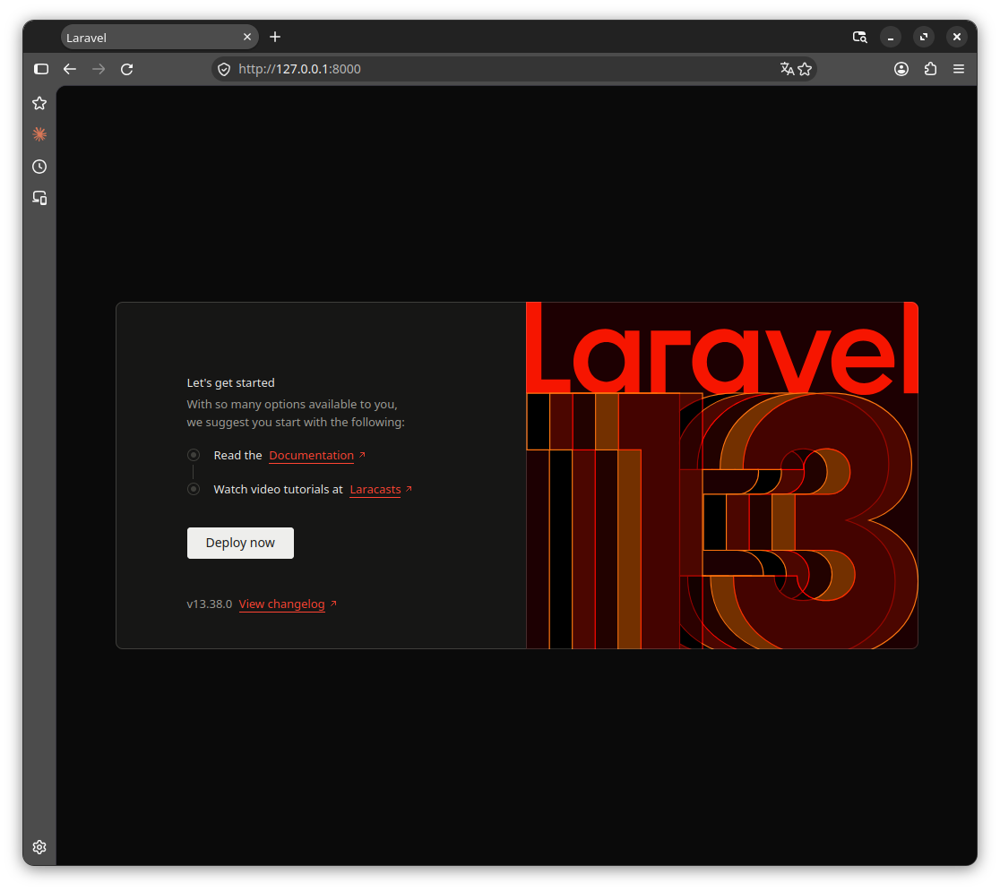

# Sportowiada — tworzenie projektu

Opis historycznego przygotowania projektu od początku. Podane wersje i wyniki dotyczą tego etapu; poleceń nie wykonujemy ponownie podczas redakcji dokumentacji.

## 1. Czysta instalacja Laravela

### 1.1. Utworzenie projektu

Pracę rozpoczynam w katalogu nadrzędnym:

```bash
cd /home/sebastian/Development/Laravel
mkdir sportowiada
composer create-project laravel/laravel sportowiada
cd sportowiada
php artisan --version
```

`cd` zmienia katalog roboczy, a `mkdir` tworzy katalog. `composer create-project` pobiera szkielet aplikacji i instaluje jego zależności. `php artisan --version` odczytuje wersję frameworka w utworzonym projekcie.

Katalog docelowy musi być pusty. Polecenie bez wskazania wersji wybiera dostępne wydanie zgodne z wymaganiami środowiska; uruchomione później nie musi utworzyć identycznego projektu. Podany niżej numer jest wynikiem naszej instalacji. Istniejący projekt odtwarzamy z repozytorium i jego `composer.lock`, używając `composer install`, zamiast ponownie wykonywać `create-project`. [Opis poleceń Composer](https://getcomposer.org/doc/03-cli.md#create-project).

Szkielet zapisany w pierwszym commicie zawierał skrypty Composer tworzące lokalny `.env`, generujące klucz aplikacji oraz przygotowujące SQLite i uruchamiające migracje z `--graceful`. Sama obecność tych skryptów nie dowodzi sukcesu każdej operacji; wersję i podstawowe działanie sprawdziliśmy osobno poniżej.

### 1.2. Sprawdzenie instalacji

Po instalacji polecenie sprawdzające zwróciło: `Laravel Framework 13.38.0`.

## 2. Inicjalizacja Git

### 2.1. Utworzenie lokalnego repozytorium

Będąc w katalogu `sportowiada`, tworzę lokalne repozytorium z gałęzią `main`:

```bash
git init -b main
```

`git init` inicjalizuje repozytorium, a `-b main` ustawia nazwę pierwszej gałęzi. Nie tworzy jeszcze repozytorium na GitHubie.

## 3. Pierwszy commit

### 3.1. Zapis początkowego stanu

Dodaję pliki Laravela i zapisuję pierwszy stan projektu:

```bash
git add .
git commit -m "Czysta instalacja Laravel"
```

`git add .` przygotowuje zmiany z bieżącego katalogu do commitu. `git commit -m` zapisuje przygotowany stan z podanym opisem. Commit jest lokalny; publikację opisano w [[02-narzedzia-deweloperskie]].

W tym momencie katalog `docs` nie jest jeszcze częścią repozytorium.

## 4. Utworzenie dokumentacji

### 4.1. Katalog i spis treści

Plik: `docs/README.md`

W katalogu głównym projektu tworzę folder dokumentacji i jego plik początkowy:

```bash
mkdir docs
touch docs/README.md
```

`touch` tworzy pusty plik, jeśli jeszcze nie istnieje. Jego zawartość uzupełniamy w edytorze.

## 5. Zapisanie dokumentacji w Git

### 5.1. Osobny commit dokumentacji

Do repozytorium dodaję tylko plik dokumentacji. Lokalne ustawienia Obsidiana w `docs/.obsidian/` pozostają poza tym commitem.

```bash
git add docs/README.md
git commit -m "Dodanie dokumentacji projektu"
```

## 6. Pominięcie lokalnych ustawień Obsidiana

### 6.1. Reguła ignorowania

Plik: `.gitignore`

Obsidian zapisuje ustawienia sejfu w katalogu `docs/.obsidian/`. Aby Git ich nie śledził, dodaję do głównego pliku `.gitignore`:

```gitignore
docs/.obsidian/
```

Reguła wyłącza nieśledzone lokalne ustawienia sejfu z dodawania do Git. Nie usuwa katalogu z dysku i nie przestaje śledzić plików, które były już wcześniej dodane do repozytorium.

### 6.2. Zapis reguły w Git

Następnie zapisuję zmianę:

```bash
git add .gitignore
git commit -m "Ignorowanie lokalnych ustawień Obsidiana"
```

## 7. Sprawdzenie podstawowych testów

### 7.1. Uruchomienie i wynik

Uruchamiam testy dołączone do świeżej instalacji Laravela:

```bash
php artisan test --compact
```

Wynik: `2 passed (2 assertions)`. Test funkcjonalny sprawdza status HTTP 200 dla `GET /`. Test jednostkowy wykonuje jedynie przykładową asercję `assertTrue(true)`; nie sprawdza logiki aplikacji.

Ten historyczny wynik dotyczy testów przykładowych, a nie późniejszego logowania i kontroli dostępu.

## 8. Uruchomienie aplikacji lokalnie

### 8.1. Serwer deweloperski

W katalogu głównym projektu uruchamiam serwer:

```bash
php artisan serve
```

Serwer działa do chwili zatrzymania procesu. Jest to sposób uruchomienia użyty na tym etapie; późniejszą konfigurację Apache opisano w [[05-konfiguracja-domeny-lokalnej]].

### 8.2. Sprawdzenie w przeglądarce

Otwieram w przeglądarce adres `http://127.0.0.1:8000`.
Wyświetla się strona powitalna Laravel.



Serwer zatrzymuję skrótem `Ctrl+C` w terminalu.
