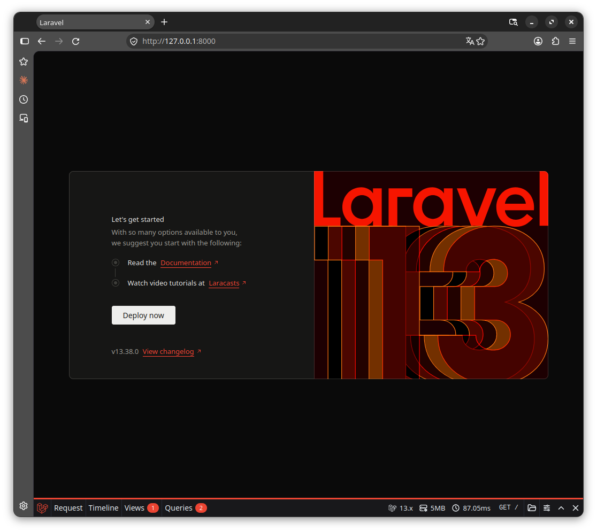

# Narzędzia deweloperskie

Opis instalacji i konfiguracji narzędzi w początkowym środowisku projektu. Wersje, SQLite i wyniki kontroli odnoszą się do tego etapu. Dokument nie jest poleceniem ponownej instalacji pakietów.

## 1. Plan narzędzi

### 1.1. Zakres początkowy

Na początku tego etapu planowaliśmy dodać:

| Pakiet | Przeznaczenie |
|---|---|
| fruitcake/laravel-debugbar | Podgląd zapytań SQL, czasu wykonania i informacji diagnostycznych podczas pracy nad aplikacją. |
| barryvdh/laravel-ide-helper | Generowanie informacji ułatwiających IDE podpowiadanie kodu Laravela. |
| larastan/larastan | Rozszerzenie PHPStan do analizy kodu wykorzystującego Laravel. |
| phpstan/phpstan | Statyczna analiza kodu PHP, pomagająca wykrywać błędy bez uruchamiania aplikacji. |
| phpro/grumphp | Automatyczne uruchamianie kontroli jakości kodu przed commitem. |
| laravel/boost | Wsparcie asystentów AI w pracy nad projektem Laravel. |

## 2. Sprawdzenie obecnych zależności

### 2.1. Lista pakietów bezpośrednich

W katalogu projektu wykonaliśmy:

```bash
composer show --direct
```

`composer show --direct` pokazuje bezpośrednie zależności projektu wraz z zainstalowanymi wersjami. Nie instaluje ani nie aktualizuje pakietów.

Żaden z planowanych pakietów nie znajdował się na liście bezpośrednich
zależności projektu.

## 3. Laravel Debugbar

Debugbar wyświetla pasek diagnostyczny w przeglądarce, który pomaga
sprawdzać m.in. zapytania SQL i czas wykonania żądania.

### 3.1. Sprawdzenie zgodności zależności

Przed instalacją sprawdziliśmy, czy wymagania nowego pakietu można
pogodzić z wersjami PHP, Laravela i pozostałych bibliotek projektu:

```bash
composer require --dev fruitcake/laravel-debugbar --dry-run
```

Opcja `--dry-run` wykonuje próbę bez instalowania pakietów i zapisywania
zmian w plikach `composer.json` oraz `composer.lock`. Pokazuje, jakie
pakiety zostałyby dodane, zaktualizowane lub usunięte.

W naszym przypadku Composer zaproponował dodanie trzech pakietów,
bez aktualizacji i usuwania istniejących zależności.

Jest to krok opcjonalny — zwykłe `composer require` również sprawdza
zgodność, a następnie przeprowadza instalację.

### 3.2. Instalacja

Zainstalowaliśmy Debugbar jako zależność deweloperską:

```bash
composer require --dev fruitcake/laravel-debugbar
```

Opcja `--dev` dodaje pakiet do sekcji `require-dev` w `composer.json`.
Dzięki temu można pominąć jego instalację na serwerze produkcyjnym,
używając `composer install --no-dev`.

Composer zainstalował:

- `fruitcake/laravel-debugbar` — 4.4.4,
- `php-debugbar/php-debugbar` — 3.8.0,
- `php-debugbar/symfony-bridge` — 1.1.0.

Laravel automatycznie wykrył pakiet. Nie wprowadzaliśmy dodatkowej
konfiguracji.

Wykrycie pakietu nie oznacza, że pasek będzie widoczny w każdej odpowiedzi. Przy domyślnych ustawieniach pakietu jego włączenie zależy od trybu debugowania (`app.debug`, zwykle ustawianego przez `APP_DEBUG`), a wstrzyknięcie paska dotyczy odpowiednich odpowiedzi HTML. Poniżej potwierdzono konkretny widok w lokalnej przeglądarce.

### 3.3. Sprawdzenie działania

Uruchomiliśmy aplikację:

```bash
php artisan serve
```

Po otwarciu strony w przeglądarce potwierdziliśmy obecność paska
Debugbara na dole strony.



### 3.4. Testy po instalacji

Po instalacji uruchomiliśmy testy:

```bash
php artisan test --compact
```

Wynik: 2 testy zakończone powodzeniem, 2 asercje.

### 3.5. Pominięcie danych diagnostycznych w Git

Debugbar zapisuje dane diagnostyczne w katalogu `storage/debugbar/`.
Nie przechowujemy ich w repozytorium.

Reguła ignorowania obejmuje pliki nieśledzone. Nie usuwa wcześniej zapisanych danych z historii Git.

Plik: `.gitignore`

Dodaliśmy regułę:

```gitignore
/storage/debugbar
```

## 4. Laravel IDE Helper

Laravel IDE Helper generuje plik z informacjami, które pomagają
edytorowi podpowiadać metody i typy Laravela.

### 4.1. Instalacja

Najpierw wykonaliśmy próbę instalacji:

```bash
composer require --dev barryvdh/laravel-ide-helper --dry-run
```

Composer zaproponował cztery nowe pakiety, bez aktualizacji i usuwania
istniejących zależności.

Następnie zainstalowaliśmy narzędzie jako zależność deweloperską:

```bash
composer require --dev barryvdh/laravel-ide-helper
```

Zainstalowana wersja: 3.7.0. Laravel automatycznie wykrył pakiet.

### 4.2. Generowanie pliku podpowiedzi

Sprawdziliśmy dostępne opcje:

```bash
php artisan ide-helper:generate --help
```

Następnie wygenerowaliśmy plik:

```bash
php artisan ide-helper:generate --no-interaction
```

Powstał plik `_ide_helper.php` w katalogu głównym projektu.
Po dodaniu kolejnych pakietów udostępniających fasady można ponownie
uruchomić to polecenie, aby odświeżyć podpowiedzi.

### 4.3. Pominięcie wygenerowanego pliku w Git

Plik: `.gitignore`

Sprawdziliśmy regułę ignorowania:

```bash
git check-ignore -v _ide_helper.php
```

Istniejący wpis `_ide_helper.php` w `.gitignore` wyklucza ten plik
z repozytorium. Nie trzeba było zmieniać reguł ignorowania.

### 4.4. Testy po instalacji

Uruchomiliśmy:

```bash
php artisan test --compact
```

Wynik: 2 testy zakończone powodzeniem, 2 asercje.

## 5. Larastan i PHPStan

PHPStan analizuje kod PHP bez uruchamiania aplikacji, pomagając
wykrywać m.in. nieprawidłowe typy i wywołania nieistniejących metod.
Larastan rozszerza tę analizę o mechanizmy Laravela.

### 5.1. Instalacja

Najpierw wykonaliśmy próbę instalacji:

```bash
composer require --dev larastan/larastan phpstan/phpstan --dry-run
```

Composer zaproponował trzy nowe pakiety, bez aktualizacji i usuwania
istniejących zależności.

Następnie wykonaliśmy instalację:

```bash
composer require --dev larastan/larastan phpstan/phpstan
```

Zainstalowane wersje:

- `larastan/larastan` — 3.13.0,
- `phpstan/phpstan` — 2.3.1,
- `iamcal/sql-parser` — 0.7.

### 5.2. Konfiguracja

Plik: `phpstan.neon`

W katalogu głównym projektu utworzyliśmy konfigurację:

```neon
includes:
    - vendor/larastan/larastan/extension.neon

parameters:
    paths:
        - app

    level: 5
```

Sekcja `includes` włącza rozszerzenie Larastan.
Parametr `paths` określa analizowane katalogi.
Poziom `5` określa rygor sprawdzania — wyższe poziomy dodają
kolejne reguły analizy.

### 5.3. Uruchomienie analizy

Wykonaliśmy:

```bash
vendor/bin/phpstan analyse
```

PHPStan automatycznie odczytał plik `phpstan.neon`.
Przeanalizował trzy pliki z katalogu `app` i nie zgłosił błędów
na poziomie 5.

### 5.4. Testy po instalacji

Uruchomiliśmy:

```bash
php artisan test --compact
```

Wynik: 2 testy zakończone powodzeniem, 2 asercje.

## 6. GrumPHP

GrumPHP uruchamia skonfigurowane kontrole jakości kodu.
Dzięki hookom Git może wykonywać je automatycznie przed commitem
i zatrzymać commit, gdy kontrola wykryje błąd.

### 6.1. Instalacja

Najpierw wykonaliśmy próbę instalacji:

```bash
composer require --dev phpro/grumphp --dry-run
```

Composer zaproponował 32 nowe pakiety, bez aktualizacji i usuwania
istniejących zależności.

Następnie zainstalowaliśmy narzędzie:

```bash
composer require --dev phpro/grumphp
```

Zainstalowana wersja GrumPHP: 2.26.0.

Podczas instalacji Composer zapytał o zgodę na uruchamianie wtyczki
`phpro/grumphp`. Odpowiedzieliśmy `y`. Zgoda została zapisana
w sekcji `config.allow-plugins` pliku `composer.json`.

Instalator utworzył plik `grumphp.yml` z pustą listą kontroli.

### 6.2. Konfiguracja PHPStan

Plik: `grumphp.yml`

Skonfigurowaliśmy kontrolę PHPStan:

```yaml
grumphp:
    tasks:
        phpstan:
            configuration: phpstan.neon
            use_grumphp_paths: false
```

Opcja `configuration` wskazuje plik konfiguracji PHPStan.

Domyślnie GrumPHP przekazuje PHPStan własną listę plików do analizy.
Podczas pierwszej próby objęła ona również testy, a PHPStan zgłosił
zawsze prawdziwą asercję `assertTrue(true)` w przykładowym teście.

Ustawienie `use_grumphp_paths: false` powoduje, że zakres analizy
pochodzi z `phpstan.neon`. W naszym projekcie jest to cały katalog `app`.

### 6.3. Ręczne uruchomienie kontroli

Wykonaliśmy:

```bash
vendor/bin/grumphp run
```

Po ustawieniu zakresu analizy kontrola PHPStan zakończyła się powodzeniem.

### 6.4. Hooki Git

Zarejestrowaliśmy hooki Git:

```bash
vendor/bin/grumphp git:init --no-interaction
```

Hooki uruchamiają GrumPHP podczas wykonywania commita.
Są lokalne i nie trafiają do repozytorium. Plik `grumphp.yml`
przechowujemy natomiast w Git.

### 6.5. Testy po instalacji

Uruchomiliśmy:

```bash
php artisan test --compact
```

Wynik: 2 testy zakończone powodzeniem, 2 asercje.

## 7. Laravel Boost

Laravel Boost wspiera asystentów AI podczas pracy nad projektem.
Dostarcza wytyczne, umiejętności oraz serwer MCP udostępniający
narzędzia związane z aplikacją.

### 7.1. Instalacja

Najpierw wykonaliśmy próbę instalacji:

```bash
composer require --dev laravel/boost --dry-run
```

Composer zaproponował cztery nowe pakiety, bez aktualizacji
i usuwania istniejących zależności.

Następnie wykonaliśmy instalację:

```bash
composer require --dev laravel/boost
```

Zainstalowane wersje:

- `laravel/boost` — 2.10.3,
- `laravel/mcp` — 1.1.0,
- `laravel/roster` — 1.0.0,
- `composer/semver` — 3.5.1.

### 7.2. Konfiguracja dla Codexa

Sprawdziliśmy opcje konfiguratora i uruchomiliśmy go:

```bash
php artisan boost:install --help
php artisan boost:install
```

Wybraliśmy:

- AI Guidelines,
- Agent Skills,
- Boost MCP Server Configuration,
- dodatkową umiejętność pakietu `fruitcake/laravel-debugbar`,
- agenta Codex.

Nie wybraliśmy integracji Laravel Cloud.

Instalator zastąpił początkowe instrukcje w `AGENTS.md`
wytycznymi dopasowanymi do projektu. Utworzył także `boost.json`
z zapisanymi ustawieniami oraz katalog `.agents/skills/`.

Zainstalowano pięć umiejętności:

- `infer-conventions`,
- `laravel-best-practices`,
- `testing-best-practices`,
- `tailwindcss-development`,
- `debug-using-debugbar`.

Pliki umiejętności zawierają instrukcje dla asystenta AI.
Przechowujemy je w repozytorium razem z `AGENTS.md` i `boost.json`.

### 7.3. Konfiguracja MCP

Plik: `.codex/config.toml`

Powstała konfiguracja:

```toml
[mcp_servers.laravel-boost]
command = "php"
args = ["artisan", "boost:mcp"]
```

Katalog `.codex` jest ignorowany przez Git zgodnie z istniejącą
regułą w `.gitignore`.

Po otwarciu Sportowiady w Codexie potwierdziliśmy połączenie
z Laravel Boost przez odczyt informacji o aplikacji.
Serwer zwrócił PHP 8.5, Laravel 13.38.0, Boost 2.10.3
oraz bazę SQLite. Sprawdzenie nie zmieniło plików projektu.

### 7.4. Kontrole po instalacji

Uruchomiliśmy kontrolę PHPStan przez GrumPHP:

```bash
vendor/bin/grumphp run
```

Kontrola zakończyła się powodzeniem.

Następnie uruchomiliśmy testy:

```bash
php artisan test --compact
```

Wynik: 2 testy zakończone powodzeniem, 2 asercje.

## 8. Publikacja repozytorium na GitHubie

Po skonfigurowaniu narzędzi opublikowaliśmy istniejące lokalne
repozytorium Git na GitHubie. Zachowaliśmy całą historię commitów.

### 8.1. Sprawdzenie przed publikacją

Najpierw sprawdziliśmy, czy katalog roboczy jest czysty:

```bash
git status --short
```

Polecenie nie zwróciło żadnych wpisów — wszystkie zmiany były zapisane
w commitach w zakresie plików śledzonych i nieignorowanych widocznych dla tej kontroli. Pliki ignorowane, takie jak lokalny `.env`, nie są w ten sposób sprawdzane.

Sprawdziliśmy obecność pliku `.env` w historii dostępnej przez lokalne referencje Git:

```bash
git log --all --oneline -- .env
```

Wynik był pusty. Następnie sprawdziliśmy, które pliki o nazwach
typowych dla danych dostępowych są obecnie śledzone:

```bash
git ls-files '.env*' 'auth.json' '*.pem' '*.key'
```

Wynik zawierał tylko `.env.example`. Obejrzeliśmy jego zawartość:

```bash
git show HEAD:.env.example
```

Pola na klucz aplikacji, hasła i klucze AWS były puste lub zawierały
wartości przykładowe. Te kontrole dotyczyły wskazanych plików i nazw;
nie stanowiły pełnego audytu całej historii repozytorium.

### 8.2. Utworzenie repozytorium na GitHubie

Na GitHubie utworzyliśmy repozytorium `SebMagacy/sportowiada` z
widocznością **Private**. Nie dodaliśmy README, `.gitignore` ani
licencji, ponieważ lokalne repozytorium miało już własne pliki
i historię commitów. Nie używaliśmy ponownie `git init`.

### 8.3. Połączenie lokalnego repozytorium z GitHubem

W katalogu projektu dodaliśmy adres zdalnego repozytorium:

```bash
git remote add origin https://github.com/SebMagacy/sportowiada.git
```

Następnie sprawdziliśmy zapisany adres:

```bash
git remote -v
```

Git pokazał ten sam adres przy `fetch` i `push`. Polecenie
`git remote add origin` dodaje nowy zdalny wpis i zakłada, że nazwa `origin` nie jest jeszcze zajęta. Nie powtarzamy go, jeśli wpis już istnieje; do zmiany jego adresu służy `git remote set-url`.

### 8.4. Wysłanie historii commitów

Wysłaliśmy istniejącą gałąź `main`:

```bash
git push -u origin main
```

Git potwierdził utworzenie zdalnej gałęzi `main` oraz ustawienie
śledzenia `origin/main`. Po odświeżeniu strony repozytorium na
GitHubie zobaczyliśmy pliki projektu i ostatni commit `8f4d0b3`
(`Potwierdź połączenie MCP z Laravel Boost`). Repozytorium pozostało
prywatne.

## 9. Zakres potwierdzonych kontroli

### 9.1. Analiza statyczna, testy i publikacja

Wyniki testów powtarzane po instalacjach dotyczą dwóch testów przykładowych: statusu HTTP 200 strony głównej i asercji `assertTrue(true)`. Nie stanowią testów działania poszczególnych pakietów. Pasek Debugbara i połączenie MCP sprawdzono osobno, w sposób opisany w odpowiednich podsekcjach.

PHPStan analizuje kod w skonfigurowanym zakresie; jego sukces nie potwierdza działania interfejsu ani połączenia z bazą. Hook GrumPHP jest kontrolą lokalną, którą można pominąć, a nie obowiązkową kontrolą na serwerze GitHub.

Opis prywatności i publikacji odnosi się do momentu wysłania tej wersji repozytorium. Nie potwierdza obecnej widoczności repozytorium ani publikacji późniejszych commitów.
